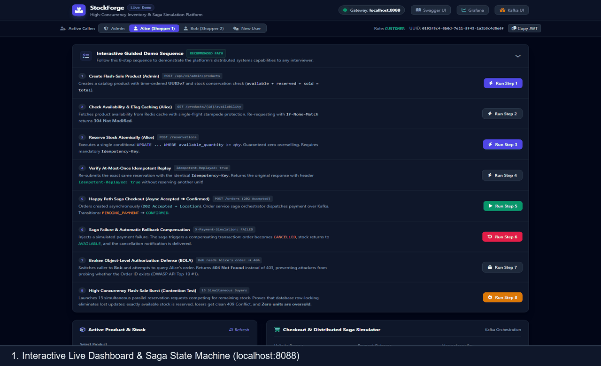
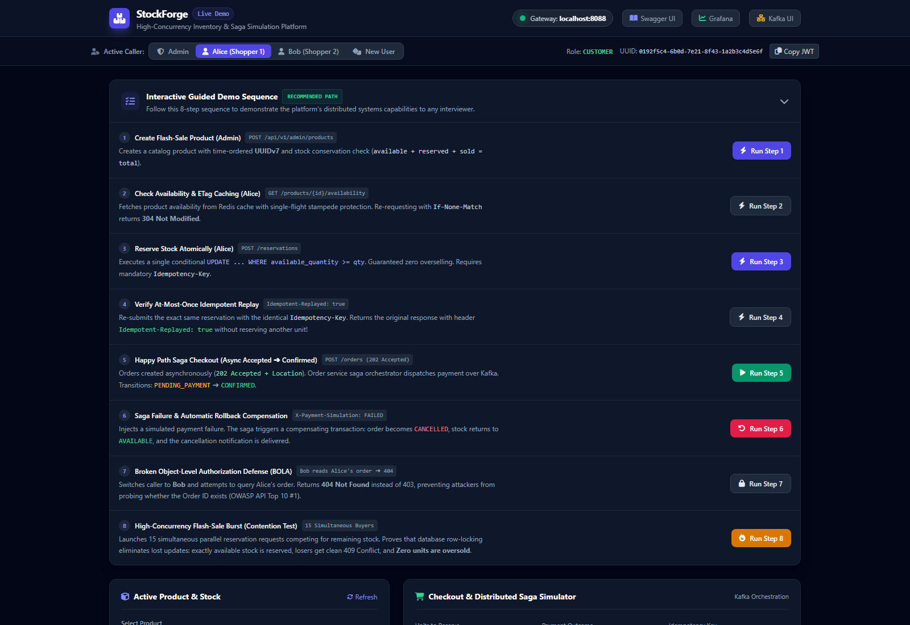
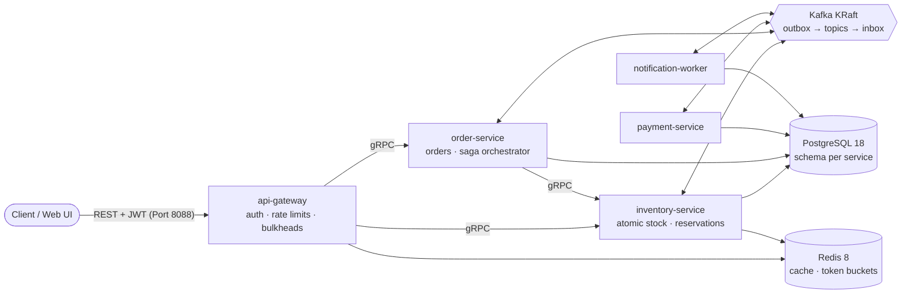
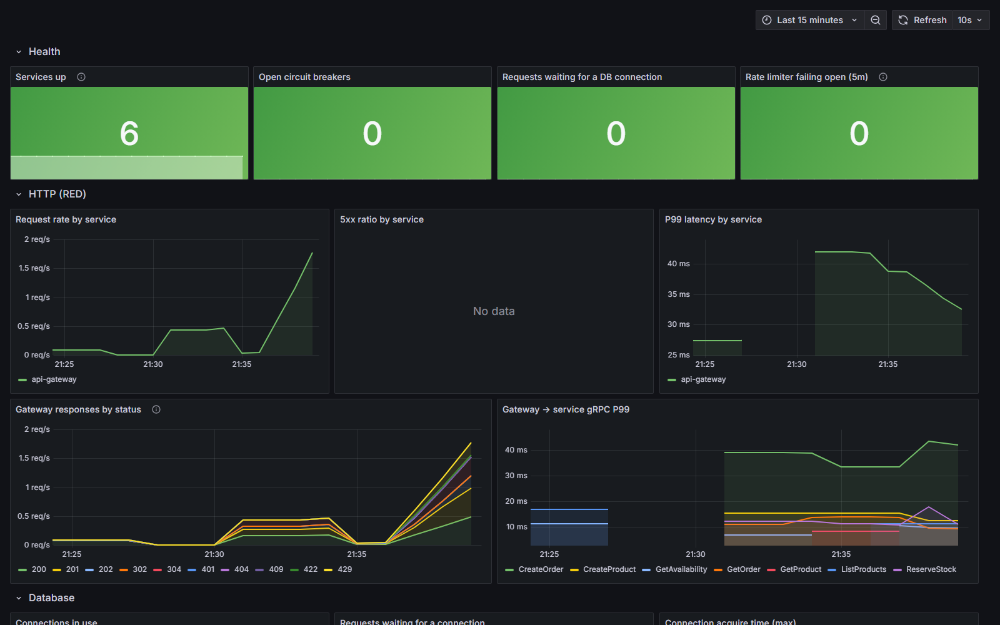
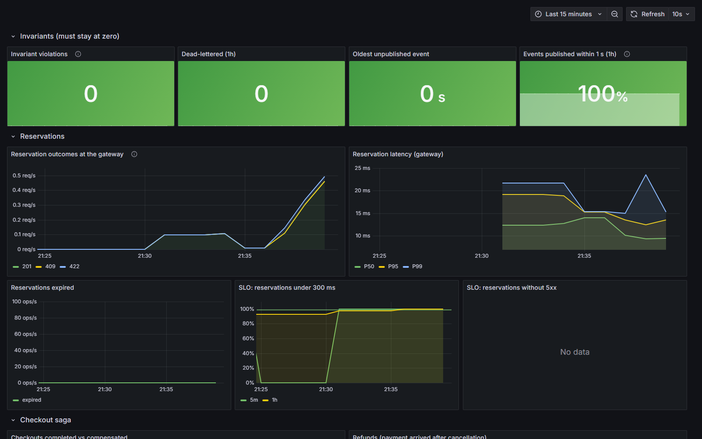
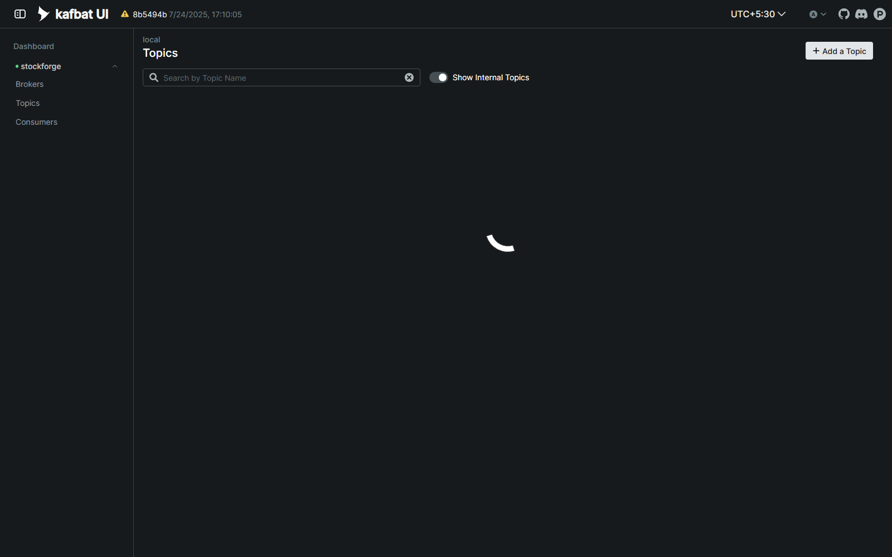

# StockForge — High-Concurrency Inventory & Reservation Platform

[](https://github.com/madhawaawishka/StockForge/actions/workflows/ci.yml)
[](https://adoptium.net/)
[](https://spring.io/projects/spring-boot)
[](https://www.postgresql.org/)
[](https://kafka.apache.org/)
[](https://redis.io/)
[](https://opentelemetry.io/)

**How do you sell 500 units to thousands of people who all click "buy" in the exact same second — without overselling, double-charging, or losing an order — and keep working when a dependency fails?**

StockForge is a production-grade, distributed flash-sale and inventory platform built with **5 Spring Boot microservices**, an **event-driven saga orchestrator over Apache Kafka (KRaft)**, and **hard mathematical guarantees**: zero overselling via atomic conditional database updates, transactional outbox/inbox messaging, automated compensation rollbacks, distributed rate limiting, and real-time observability.

---

## 🎬 Live Platform Demo Walkthrough



*The automated walkthrough cycles through the interactive live dashboard (`http://localhost:8088/`), Grafana system overview, business invariant tracking, Kafka event stream topics, and OpenAPI interactive documentation.*

---

## 🌐 Web Portals & Operational UIs

When the platform is running, access all developer tools and management consoles directly in your browser:

| Portal / Tool | URL | Default Credentials / Purpose |
| :--- | :--- | :--- |
| **Interactive Demo Dashboard** | [http://localhost:8088/](http://localhost:8088/) | Complete interactive showcase: User switcher (Admin, Alice, Bob), live stock meter, saga pipeline, and 8-step demo accordion |
| **Swagger UI / OpenAPI** | [http://localhost:8088/swagger-ui.html](http://localhost:8088/swagger-ui.html) | Interactive REST API tester & documentation (port 8088 configured in `.env`) |
| **Grafana** | [http://localhost:3000](http://localhost:3000) | Anonymous Admin. Real-time RED metrics, JVM stats, latency percentiles & invariants |
| **Kafka UI** | [http://localhost:8090](http://localhost:8090) | Inspect Kafka topics (`order-events`, `inventory-events`), message payloads & consumer lag |
| **Prometheus** | [http://localhost:9090](http://localhost:9090) | Metric scrape targets, SLO burn-rate recording rules & alerts (`/alerts`) |
| **PostgreSQL** | `localhost:5432` | DB: `stockforge`, User: `stockforge_admin`, Pass: `admin_local_only` |
| **Redis** | `localhost:6379` | Cache-aside & token-bucket rate limiter. No password |

---

## 🚀 Interactive Live Showcase (`http://localhost:8088/`)

The platform features a built-in single-page workbench designed for live demonstrations, technical interviews, and architectural evaluation.



### Key Capabilities Built into the Interface:
1. **Zero-Configuration Persona Switching:**
   * Switch between **Admin** (`ROLE_ADMIN`), **Alice** (`CUSTOMER`), **Bob** (`CUSTOMER`), or generate a **Random New User** with a single click.
   * Client-side WebCrypto automatically signs valid HMAC-SHA256 JWT tokens using the local development secret—no external identity provider or CLI tools required.
   * A **Copy JWT** button enables instant token copying for testing in Swagger UI or `curl`.
2. **Interactive 8-Step Accordion Demo Sequence:**
   * Expand the guided demo sequence at the top of the dashboard.
   * Execute steps sequentially (**Run Step 1** through **Run Step 8**) to test every distributed system guarantee:
     * **Step 1 — Create Flash-Sale Product (Admin):** Mints UUIDv7 product with stock conservation invariants (`available + reserved + sold = total`).
     * **Step 2 — Check Availability & ETag Caching (Alice):** Conditional GET returns `304 Not Modified` on cache hits with zero database load.
     * **Step 3 — Reserve Stock Atomically (Alice):** Executes conditional SQL `UPDATE ... WHERE available_quantity >= qty` with mandatory `Idempotency-Key`.
     * **Step 4 — Verify At-Most-Once Idempotent Replay:** Re-submits the exact same reservation payload. Confirms header `Idempotent-Replayed: true` with zero extra stock deduction.
     * **Step 5 — Happy-Path Saga Checkout:** Submits order via `202 Accepted + Location`, triggers Kafka saga, and watches state advance to `CONFIRMED`.
     * **Step 6 — Saga Failure & Automatic Compensation:** Injects `X-Payment-Simulation: FAILED`, triggers compensating transactions, transitions order to `CANCELLED`, restores stock to `AVAILABLE`, and fires a cancellation notification.
     * **Step 7 — Broken Object-Level Authorization (BOLA Defense):** Switches to Bob and attempts to read Alice's order. The gateway returns `404 Not Found` instead of `403`, preventing ID harvesting (OWASP API Top 10 #1).
     * **Step 8 — High-Concurrency Flash-Sale Burst:** Fires 15 parallel simulated buyers competing for remaining stock via `Promise.all()`. Proves database row-locking eliminates lost updates: winners get `201 Created`, losers get clean `409 Conflict`, and zero units are oversold.
3. **Live Product Stock Distribution Meter:**
   * Visual multi-colored progress bar dynamically displaying real-time allocation of Available (Green), Reserved (Amber), and Sold (Indigo) quantities.
4. **Saga State Machine Stepper & Audit Trail:**
   * Interactive 4-node pipeline tracker with complete timestamped audit history (`order_status_history`).
5. **Live HTTP & Problem Details Console:**
   * Inspects HTTP methods, paths, status badges, response headers (`Idempotent-Replayed`, `Location`), RFC 9457 Problem Details, and latency timings in real time.

---

## 📊 Measured Benchmark Results (Evidence, Not Claims)

Every benchmark was measured on reproducible hardware under realistic high-concurrency open-model arrival rates ([docs/benchmarks](docs/benchmarks/README.md)):

| Metric / Dimension | Result | Empirical Evidence & Operational Analysis |
| :--- | :--- | :--- |
| **Oversell Guarantee** | **0 Units** | In a 500-unit flash sale with 5,000 buyers arriving at 500 req/s, exactly 500 units were sold across all runs. Zero double allocations. |
| **Latency Under Load** | **P99: 119–254 ms** | Reservation P99 latency maintained between 119–254 ms at 500 req/s through the gateway (objective: <300 ms). Sold-out responses answered in **4–5 ms** median. |
| **Concurrency Strategy** | **Atomic UPDATE** | Atomic conditional `UPDATE ... WHERE available_quantity >= qty` yielded 0 errors. Both pessimistic (`SELECT FOR UPDATE`) and optimistic (`@Version`) locking starved connection pools (up to 191 waiting connections) — optimistic locking also undersold due to rollback discard rates. |
| **Virtual Threads** | **P99: 119–217 ms** | Java 21 Virtual Threads improved gateway P99 latency to **119–217 ms vs. 383–955 ms** on standard platform threads under identical load. |
| **Partial Indexes** | **0.8 ms / 0.4 ms** | Reservation expiry and outbox relay polling queries executed in **0.8 ms and 0.4 ms** instead of 55 ms and 328 ms across 0.5M and 1.15M rows. |
| **Fault Resilience** | **Zero Data Loss** | Redis outage ➔ reads served from PostgreSQL; DB network partition ➔ 503 + `Retry-After` bounded by socket timeouts with self-recovery; Kafka broker paused ➔ events safely buffered in outbox table and delivered upon reconnection; instance killed mid-flight ➔ idempotent consumers safely resume without duplication. |

> Every load run concludes with an automated database invariant verification check ([`scripts/check-invariants.sql`](scripts/check-invariants.sql)).

---

## 🏗️ Architecture & Distributed Systems Design



### Architectural Principles:
* **Strict Hexagonal Architecture (Ports & Adapters):** Pure Java domain core, use cases as plain classes, and framework-independent adapters. Architectural boundaries and package isolation are enforced automatically by **ArchUnit** tests in every build.
* **Database Isolation (Schema-per-Service):** Each microservice owns an isolated schema (`inventory`, `orders`, `payment`, `notification`) with dedicated database credentials. Microservices never join tables across schemas; communication occurs strictly via versioned Protobuf contracts over gRPC or Kafka events.
* **Orchestrated Saga Pattern:** The Order Service acts as the saga orchestrator. When checkout begins, it coordinates payment processing, stock confirmation, and compensation rollbacks across distributed boundaries:
  ```
  [Order Created] ➔ PENDING_PAYMENT
       │
       ├─ (Success) ➔ PaymentCaptured ➔ CONFIRMED ➔ OrderFulfilled (Stock Marked SOLD)
       │
       └─ (Failure) ➔ PaymentFailed   ➔ CANCELLED ➔ ReleaseReservation (Stock Returned to AVAILABLE)
  ```
* **Transactional Outbox & Idempotent Inbox:** All state changes and domain events are written atomically within the same local database transaction. A dedicated background relay queries unpublished outbox records using `FOR UPDATE SKIP LOCKED` and publishes them to Kafka. Consumers verify incoming event UUIDs against an inbox table before processing, guaranteeing at-least-once transport with exactly-once business processing.
* **BOLA Defense (OWASP API Security Top 10 #1):** Object ownership is strictly verified at the service domain layer. If a user attempts to access an order or reservation belonging to another customer, the API returns **404 Not Found** instead of 403 Forbidden to prevent resource enumeration and attacker discovery.

---

## 📈 Observability & Operational Verification

### 1. Grafana System Overview Dashboard
Real-time monitoring of RED metrics (Rate, Errors, Duration), JVM heap and thread utilization, connection pool wait queues, and gRPC downstream latencies:



### 2. Grafana Business Invariants & Stock Conservation
Real-time mathematical audit verifying that `available + reserved + sold = total` across all active products, tracking outbox queue depth, saga completion ratios, and expired reservation cleanups:



### 3. Kafka UI Topic & Consumer Lag Inspection
Inspect partitions, event schemas, offset commits, and consumer lag across all asynchronous channels:



---

## ⚡ Quick Start Guide

### Prerequisites
* **Docker Desktop** (running on Windows, macOS, or Linux)
* **Python 3.10+** (for generating local dev tokens)
* **JDK 21+ & Maven** (only required if building/running services outside Docker)

### 1. Start the Complete Platform
Clone the repository and launch the full stack (all 5 microservices, PostgreSQL 18, Redis 8, Kafka KRaft, Observability LGTM, and Kafka UI):

```bash
# Starts all containers with health checks and wait conditions
docker compose --profile apps --profile tools up -d --build --wait
```

*(Note: On Windows machines where port 8080 is reserved by system services like HTTP.sys, the gateway automatically binds to port **8088** via `.env`)*

### 2. Open the Interactive Showcase
Open your browser to:
👉 **[http://localhost:8088/](http://localhost:8088/)**

Click **Run Step 1** through **Run Step 8** inside the accordion to experience the full operational flow!

---

## 🛠️ Fast Incremental Rebuilding (No `docker compose down` Needed!)

> [!TIP]
> **You NEVER need to run `docker compose down` when you modify application code!**
> Running `down` stops all containers, tears down Docker networks, and running `down -v` wipes your test databases and Kafka state.

Instead, use standard incremental rebuilds:

### Option A: Rebuild ONLY the single service you modified (FASTEST — 5 to 15 seconds)
If you only changed code in one microservice (e.g. `api-gateway`, `inventory-service`, `order-service`):
```bash
docker compose --profile apps up -d --build <service-name>

# Examples:
docker compose --profile apps up -d --build api-gateway
docker compose --profile apps up -d --build inventory-service
```
*PostgreSQL, Redis, Kafka, Grafana, and all other services stay completely running without losing any state or data!*

### Option B: Rebuild all services with changes
If you changed shared modules (`libs/proto`, `libs/outbox-starter`):
```bash
docker compose --profile apps --profile tools up -d --build --wait
```
Docker Compose checks build caches, rebuilds only the invalidated layers, and restarts only the modified containers.

---

## 🧪 Comprehensive Testing Matrix

StockForge is verified by an automated test suite across all layers of the testing pyramid:

```bash
# Run all tests, linting, architecture rules, and formatting checks:
./mvnw verify
```

| Test Suite | Technologies | Verification Scope |
| :--- | :--- | :--- |
| **Domain & Use-Case Unit Tests** | JUnit 6, AssertJ, Mockito | Pure Java business logic, state machine transitions, validation invariants, and idempotent replays. |
| **Property-Based Invariant Tests** | jqwik | Mathematical verification that inventory conservation laws hold under pseudo-randomized operation sequences. |
| **Architecture Rules** | ArchUnit | Strict enforcement of hexagonal architecture: no framework leakage into domain core, no direct cross-service dependencies. |
| **Contract & Schema Tests** | Protobuf, Buf CLI, JSON Schema | Golden contract verification and backward-compatibility checking across gRPC APIs and Kafka event schemas. |
| **Testcontainers Integration Tests** | Testcontainers, PostgreSQL 18, Kafka 4, Redis 8 | End-to-end API flows, database constraints, outbox relaying, dead-letter topic routing, and multi-threaded race conditions (32 threads, 400 attempts, 100 units). |
| **Chaos & Fault-Injection Tests** | Toxiproxy, WireMock | Resilience under network partitions, Redis outages, Kafka broker pauses, connection timeouts, and mid-flight SIGKILL signals. |
| **SLO & Alert Rule Tests** | promtool | Unit testing Prometheus alerting rules and multi-window burn-rate SLO calculations. |
| **Load & Contention Benchmarks** | Grafana k6 (`load-tests/`) | Smoke, flash-sale contention, checkout saga under load, traffic spikes, and endurance soak tests under open-model arrival rates. |
| **Automated Invariant Audit** | PostgreSQL, SQL Scripts | Validates that all database invariants hold after every load run (`scripts/verify-invariants.ps1`). |

---

## 📋 Public REST API Reference (API Gateway)

All shopper requests pass through the API Gateway, which enforces JWT validation, token-bucket rate limiting, and request correlation tracing:

| HTTP Method | Path | Auth / Role | Description & Operational Behavior |
| :--- | :--- | :--- | :--- |
| `GET` | `/api/v1/products` | Public | Paginated product catalog. Cache-aside in Redis with single-flight stampede protection. |
| `GET` | `/api/v1/products/{id}/availability` | Public | Real-time stock availability. Evaluates `If-None-Match` and returns **304 Not Modified** on cache hits. |
| `POST` | `/api/v1/reservations` | Customer | Reserves stock atomically. Requires `Idempotency-Key`. Returns `201 Created`, `409 Conflict` (sold out), or `429 Too Many Requests`. |
| `GET` | `/api/v1/reservations/{id}` | Customer | Retrieves reservation details. Enforces owner authorization (returns `404` to non-owners). |
| `POST` | `/api/v1/reservations/{id}/cancel` | Customer | Manually cancels an active reservation and releases held stock. |
| `POST` | `/api/v1/orders` | Customer | Initiates checkout saga. Returns **`202 Accepted`** with `Location` header; payment executes asynchronously. |
| `GET` | `/api/v1/orders/{id}` | Customer | Polls order status and full audit history (`order_status_history`). Protected against BOLA attacks. |
| `POST` | `/api/v1/admin/products` | `ADMIN` | Creates new catalog products with initial stock buckets. Audited and validated against ISO currencies. |
| `POST` | `/api/v1/admin/products/{id}/stock-adjustments` | `ADMIN` | Adjusts warehouse inventory levels with audit logging and invariant checks. |
| `POST` | `/api/v1/admin/dead-letters/{topic}/replay` | `ADMIN` | Replays poison-pill messages from dead-letter topics back to primary queues after remediation. |

*All error responses adhere to **RFC 9457 Problem Details** (`application/problem+json`) with standardized error URIs and distributed trace IDs ([docs/api/problems.md](docs/api/problems.md)).*

---

## 📁 Repository Structure

```
StockForge/
├── services/
│   ├── api-gateway/            # Spring Cloud Gateway / Spring MVC, JWT auth, rate limiting, OpenAPI
│   ├── inventory-service/      # Atomic stock reservations, gRPC server, PostgreSQL schema, outbox relay
│   ├── order-service/          # Order lifecycle, saga state machine orchestrator, compensation handlers
│   ├── payment-service/        # Idempotent payment gateway simulator, timeout handlers, refund workers
│   └── notification-worker/    # Event-driven consumer for order confirmations and cancellation alerts
├── libs/
│   ├── proto/                  # Protobuf contracts for internal high-performance gRPC communication
│   ├── event-schemas/          # Golden JSON schema definitions for domain events published to Kafka
│   └── outbox-starter/         # Reusable Spring Boot starter for transactional outbox & idempotent inbox
├── web/                        # Lightweight single-page interactive showcase dashboard (HTML/JS)
├── load-tests/                 # Grafana k6 scenarios (smoke, flash-sale, checkout, contention, soak)
├── observability/              # Prometheus alert rules, recording rules, and Grafana dashboard definitions
├── database/                   # Initial SQL schema migrations, roles, and seed scripts
├── docs/                       # Architectural diagrams (C4), ADRs, benchmarks, postmortems, and security reviews
└── scripts/                    # Helper scripts (dev-token.py, invariant validators, traffic generators)
```

---

## 📚 In-Depth Engineering Documentation

* [Architectural Design & C4 Diagrams](docs/architecture/README.md) — Comprehensive context, container, and sequence diagrams for all checkout workflows.
* [Architecture Decision Records (ADRs)](docs/decisions/README.md) — 14 documented architectural decisions (schema-per-service, outbox polling, fail-open rate limiting).
* [Benchmark Reports & Performance Analysis](docs/benchmarks/README.md) — Hardware specifications, locking strategy comparisons, and virtual thread profiling.
* [Incident Postmortems](docs/postmortems/README.md) — Case studies of seven real distributed race conditions discovered and resolved during development.
* [Security Assessment (OWASP Top 10)](docs/security.md) — Complete threat model mapping vulnerabilities (BOLA, rate limiting, injection) to defensive controls.
* [SLO Definitions & Runbooks](docs/observability/slos.md) — Production service-level objectives, multi-window error budget burn-rate alerts, and on-call runbooks.
* [Running & Testing Guide](RUNNING_AND_TESTING_GUIDE.md) — Hands-on step-by-step testing manual and CLI recipes.

---

## 🛠️ Technology Stack Summary

* **Core Backend:** Java 21 (Virtual Threads), Spring Boot 4.1.1, Spring Security, Spring Data JDBC, gRPC Java
* **Data Storage & Messaging:** PostgreSQL 18.6, Flyway, Redis 8.8, Apache Kafka 4.3.1 (KRaft Mode)
* **Resilience & Governance:** Resilience4j (Circuit Breakers, Bulkheads), Bucket4j, Transactional Outbox
* **Observability & Telemetry:** Micrometer, OpenTelemetry, Prometheus, Grafana LGTM, Grafana Tempo, Kafka UI
* **Quality Assurance:** JUnit 6, Testcontainers, Toxiproxy, ArchUnit, jqwik, Error Prone, Spotless, Grafana k6

---

## 📄 License
This project is open-source and available under the [MIT License](LICENSE).
