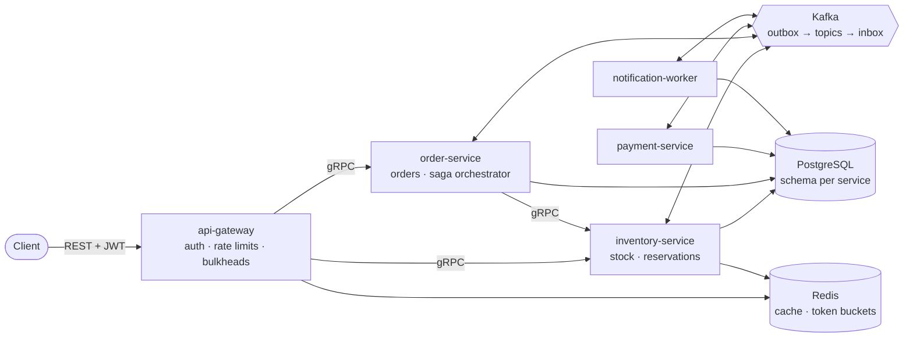

# StockForge — High-Concurrency Inventory & Reservation Platform

[](https://github.com/madhawaawishka/StockForge/actions/workflows/ci.yml)

**How do you sell 500 units to thousands of people who all click "buy" in the same second — without overselling,
double-charging or losing an order — and keep working when a dependency fails?**

StockForge answers that with five Spring Boot services, a checkout saga over Kafka, and evidence: concurrency tests,
fault-injection tests, load tests with measured numbers, and written-up decisions and incidents.

## Results (measured, not estimated)
| | |
| :--- | :--- |
| **Oversell** | 0 — a 500-unit flash sale with 5,000 buyers at 500 req/s sold exactly 500 units in every run, with all three locking strategies |
| **Latency** | reservation P99 **119–254 ms** at 500 req/s through the gateway (objective: 300 ms); sold-out answers in **4–5 ms** median |
| **Strategy choice** | atomic conditional `UPDATE`: 0 errors. Pessimistic and optimistic locking starved the connection pool (up to 191 waiting) — optimistic also *undersold* |
| **Virtual threads** | gateway P99 **119–217 ms vs 383–955 ms** on platform threads at the same load |
| **Partial indexes** | expiry and outbox polls **0.8 ms / 0.4 ms** instead of 55 ms / 328 ms on 0.5 M / 1.15 M rows |
| **Failure behaviour** | Redis down → reads served from PostgreSQL; database partition → 503 + `Retry-After`, bounded by the JDBC socket timeout, and self-recovery; Kafka paused → events buffered, then delivered; instance stopped mid-request → request completes |

How these were measured, on what hardware, and the runs that went badly: [docs/benchmarks](docs/benchmarks/README.md).
Every load run ends with a database invariant check ([`scripts/check-invariants.sql`](scripts/check-invariants.sql)).

## Architecture

- **Hexagonal services** — pure-Java domain, use cases as plain classes, adapters at the edge; enforced by ArchUnit.
- **One schema and role per service**; services share only contracts (protobuf, event payloads).
- **Checkout as an orchestrated saga** with compensations, a payment timeout, and refunds for payments that arrive
  after the reservation expired.
- **Exactly-once effects** from a transactional outbox, idempotent consumers, and dead-letter topics with replay.

C4 views and sequence diagrams of every flow: [docs/architecture](docs/architecture/README.md).

## Engineering highlights
| Problem | Solution | Proof |
| :--- | :--- | :--- |
| Overselling under contention | atomic conditional update; stock invariant as a CHECK constraint; 3 strategies benchmarked | `StockReservationConcurrencyIT`, [benchmark](docs/benchmarks/concurrency-strategies.md) |
| Purchase-limit write skew | counter row with `active ≤ limit` enforced by the database | `PurchaseLimitWriteSkewIT` |
| Duplicate requests | `Idempotency-Key` stored in the same transaction as the business write; replays return the original response | `ReservationApiIT`, smoke test |
| Lost or duplicated events | outbox relay (`SKIP LOCKED`, ordered, ack before `PUBLISHED`) + inbox keyed by event id | `MessagingIT` with real Kafka |
| Distributed workflow | orchestrated saga, explicit saga state with a DB constraint, compensation and refund paths | `CheckoutSagaTest`, `CheckoutSagaIT` |
| Dependency failures | timeouts everywhere, circuit breakers, bulkheads, fail-open rate limiting, 503 + `Retry-After` | `InventoryChaosIT` (Toxiproxy), [ADR-010](docs/decisions/ADR-010-rate-limiter-fails-open.md) |
| Hot reads | Redis cache-aside, single-flight on misses, after-commit invalidation | `ProductCatalogQueriesCacheTest` |
| Broken object-level authorization | owner checked by the owning service; other users' objects are *not found* | `GatewayApiIT`, `OrderQueriesTest` |
| Operability | RED + business metrics, traces through Kafka, SLO burn-rate alerts with unit tests, runbooks | [observability](observability/), [SLOs](docs/observability/slos.md), [runbooks](docs/runbooks/README.md) |

## Quick start
**Prerequisites:** Docker (Docker Desktop on Windows/macOS). JDK 21+ only for building and running tests outside Docker.

```bash
# Everything in containers: 5 services, PostgreSQL, Redis, Kafka, Grafana/Prometheus/Tempo
docker compose --profile apps up -d --build --wait
#   (if port 8080 is taken: GATEWAY_PUBLIC_PORT=8088 docker compose --profile apps up -d --build --wait)
```

**Try a checkout** (tokens are signed with the local-only development key; use your `GATEWAY_PUBLIC_PORT` instead of
8080 if you changed it):
```bash
ADMIN=$(python scripts/dev-token.py --admin)
ME=$(python scripts/dev-token.py)

# Create a product with 100 units
curl -s -X POST localhost:8080/api/v1/admin/products -H "Authorization: Bearer $ADMIN" \
  -H 'Content-Type: application/json' \
  -d '{"sku":"SNEAKER-RED-42","name":"Limited sneaker","price":{"amount":"119.00","currency":"USD"},"initialStock":100}'

# Reserve 1 unit (the Idempotency-Key makes retries safe), then order it
curl -s -X POST localhost:8080/api/v1/reservations -H "Authorization: Bearer $ME" -H "Idempotency-Key: res-$RANDOM$RANDOM" \
  -H 'Content-Type: application/json' -d '{"productId":"<product id>","quantity":1}'
curl -s -X POST localhost:8080/api/v1/orders -H "Authorization: Bearer $ME" -H "Idempotency-Key: ord-$RANDOM$RANDOM" \
  -H 'Content-Type: application/json' -d '{"reservationId":"<reservation id>"}'      # 202 Accepted
curl -s localhost:8080/api/v1/orders/<order id> -H "Authorization: Bearer $ME"          # CONFIRMED + history
```
Or run the whole flow, including security checks, with k6:
```bash
docker run --rm --network stockforge_default -e BASE_URL=http://api-gateway:8080 \
  -v "$PWD/load-tests:/scripts" grafana/k6:1.3.0 run /scripts/smoke.js
```

| URL | |
| :--- | :--- |
| http://localhost:8080/swagger-ui.html | API documentation (enabled in the local stack) |
| http://localhost:3000 | Grafana — *StockForge* folder: system overview, business flow & invariants |
| http://localhost:9090/alerts | Prometheus alerts |
| http://localhost:8090 | Kafka UI (`docker compose --profile tools up -d`) |

**Check that everything above works**: `bash scripts/verify-readme.sh` walks this README against the running stack
(44 checks: the checkout, every status code in the API table, ownership, idempotency, dead-letter replay, API docs,
dashboards, alert rules, Kafka UI, and one trace across all five services). CI runs it on every pull request.

**Developing a service on the host** instead: `docker compose up -d --wait` starts only the infrastructure, then
`./mvnw -pl services/inventory-service spring-boot:run -Dspring-boot.run.profiles=local` (same for the other
services; on Windows PowerShell use `.\mvnw.cmd`). Prometheus scrapes services on the host too. If port 8080 is taken,
start the gateway with `GATEWAY_HTTP_PORT=8088`.

## Public API (gateway)
| Method | Path | Notes |
| :--- | :--- | :--- |
| GET | `/api/v1/products`, `/api/v1/products/{id}`, `/api/v1/products/{id}/availability` | public; product and availability answer `If-None-Match` with 304; availability may be `approximate` (cached) |
| POST | `/api/v1/reservations` | `Idempotency-Key`; 201, 409 sold out, 422 limit, 429 rate limited |
| GET · POST | `/api/v1/reservations/{id}` · `/api/v1/reservations/{id}/cancel` | owner only |
| POST | `/api/v1/orders` | `Idempotency-Key`; 202 Accepted — payment is asynchronous |
| GET | `/api/v1/orders`, `/api/v1/orders/{id}` | owner only; keyset pagination; status history |
| POST | `/api/v1/admin/products`, `/api/v1/admin/products/{id}/stock-adjustments`, `/api/v1/admin/dead-letters/{topic}/replay` | `ADMIN` role; audited |

Errors are RFC 9457 Problem Details with stable types: [docs/api/problems.md](docs/api/problems.md).

## Testing
```bash
./mvnw verify    # Error Prone, Spotless, unit, architecture and Testcontainers integration tests, coverage
```
| Suite | What it proves |
| :--- | :--- |
| Domain and use-case unit tests (in-memory fakes) | business rules, state machines, saga transitions, idempotent replays |
| Property-based tests (jqwik) | inventory invariants hold for any sequence of operations |
| Architecture tests (ArchUnit) | hexagonal dependency rules in every service |
| Contract tests | every event payload against a golden JSON file; `buf lint`/`buf breaking` on the protos |
| Integration tests (PostgreSQL 18, Kafka 4, Redis 8 in containers) | APIs end to end, DB constraints, concurrency (400 attempts / 32 threads / 100 units), outbox and saga over a real broker |
| Chaos tests (Toxiproxy) | Redis outage, database partition, Kafka pause, graceful shutdown mid-request |
| Alert-rule tests (`promtool test rules`) | alerts fire on the right metrics and thresholds |
| Load tests (k6, `load-tests/`) | smoke, flash sale, checkout, spike, soak — open-model arrival rates |
| README checks (`scripts/verify-readme.sh`) | every promise of this README, against the running containers |

CI runs all of it on every pull request, plus Trivy (dependencies, Dockerfile, Terraform, images), gitleaks, and a job
that builds the images, starts the whole stack and runs the smoke test, a short flash sale, the README checks and the
invariant check.

## Repository
```
services/        api-gateway, inventory-service, order-service, payment-service, notification-worker
libs/            proto (gRPC contracts), event-schemas (event payloads), messaging (outbox/inbox/DLT library)
load-tests/      k6 scenarios          observability/  Prometheus rules (+ tests), Grafana dashboards
infra/terraform/ AWS reference deployment (validated, not applied)
database/        local init (roles, schemas) and large-dataset seed + EXPLAIN scripts
docs/            architecture, decisions, benchmarks, postmortems, runbooks, SLOs, security, API problems
```

## Documentation
- [Architecture](docs/architecture/README.md) — C4 views, sequence diagrams
- [Decisions](docs/decisions/README.md) — 14 ADRs, from schema-per-service to fail-open rate limiting
- [Benchmarks](docs/benchmarks/README.md) — strategies, virtual threads, pool sizing, query plans, profiling
- [Postmortems](docs/postmortems/README.md) — seven real defects, how they were found, what prevents them now
- [Security review](docs/security.md) — OWASP API Top 10 mapped to controls and tests
- [SLOs](docs/observability/slos.md) and [runbooks](docs/runbooks/README.md)
- [AWS deployment](infra/terraform/README.md) · [Specification](high_concurrency_inventory_reservation_project_specification.md) · [Progress](PROGRESS.md)

## Tech stack
Java 21 · Spring Boot 4.1 (MVC, Security, gRPC, Kafka, JDBC) · PostgreSQL 18 · Flyway · Redis 8 · Apache Kafka 4
(KRaft) · Resilience4j · Micrometer + OpenTelemetry · Prometheus · Grafana · Tempo · JUnit 6 · Testcontainers ·
Toxiproxy · ArchUnit · jqwik · Error Prone · k6 · Docker · Terraform · GitHub Actions

## Limitations
Single-node local deployment; benchmark numbers come from one laptop running everything, including the load
generator. The sold-out latency objective (P99 < 50 ms) is not yet met at 500 req/s. No identity provider (tokens are
minted locally), no mTLS between services. See [docs/security.md](docs/security.md#known-gaps-and-next-steps).
