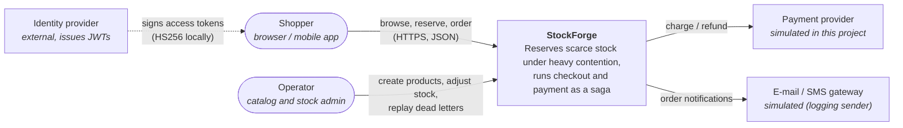
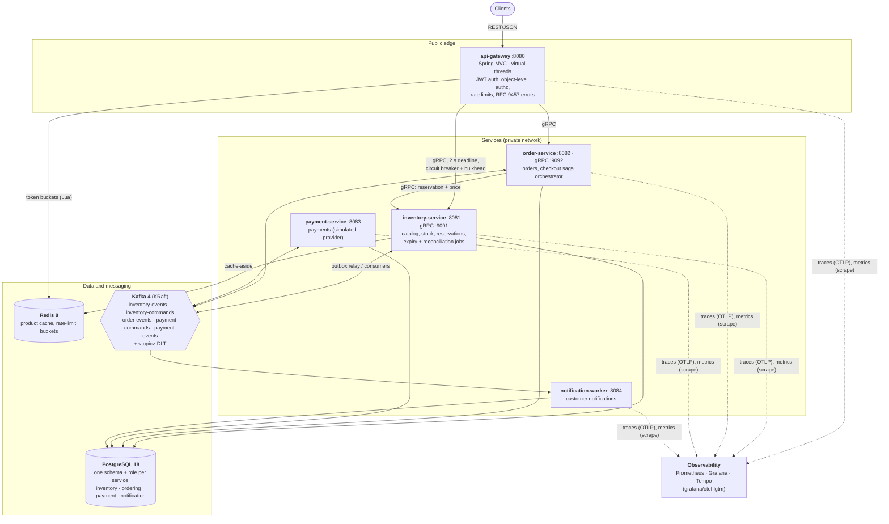
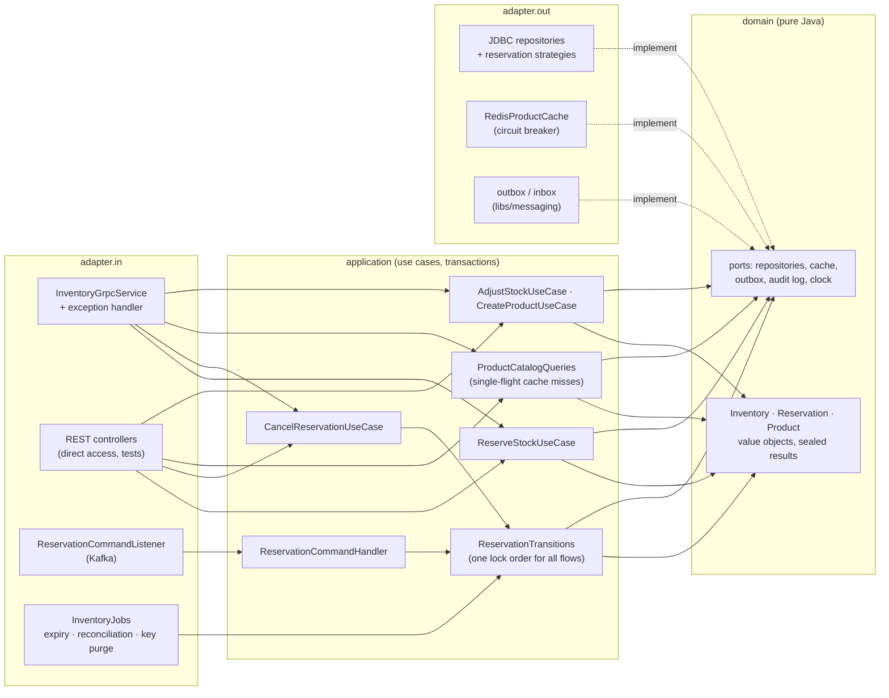
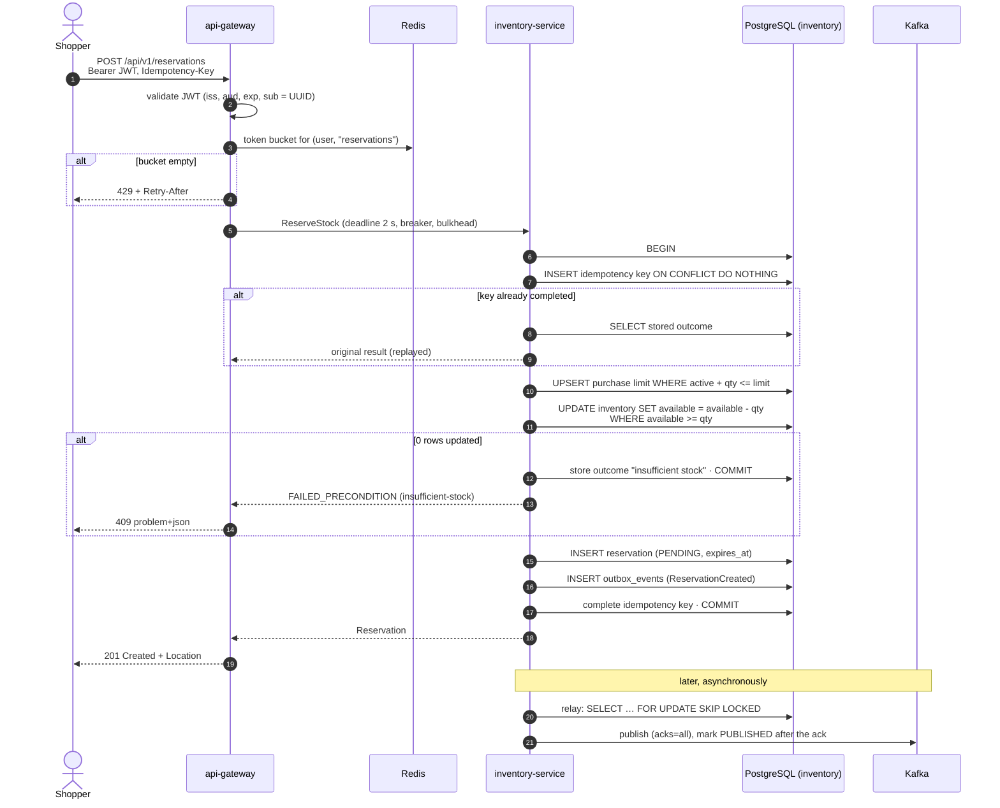
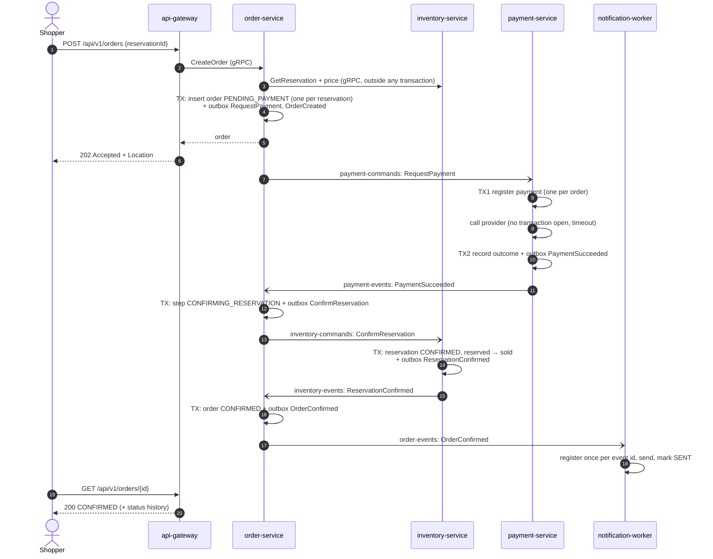
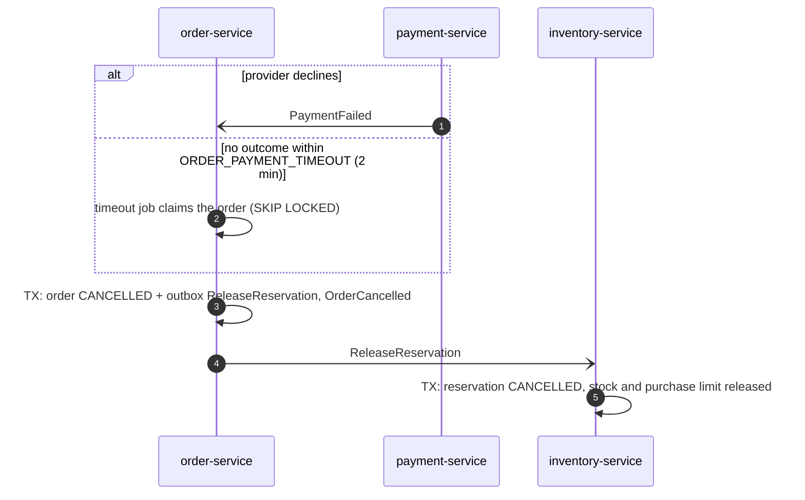
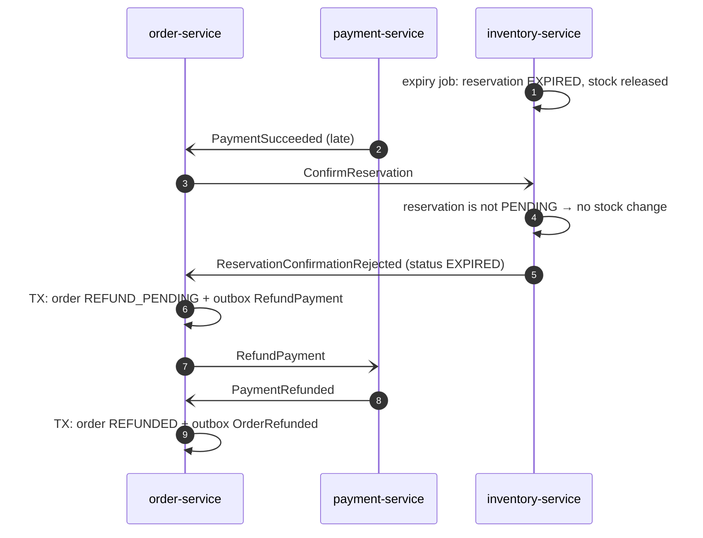
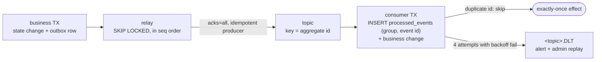

# StockForge architecture

C4 views (context → containers → components) and the sequence diagrams of the flows that matter for correctness.
Diagrams are Mermaid, so they render on GitHub and stay next to the code they describe. Decisions behind them are in
[`docs/decisions/`](../decisions/README.md).

## 1. System context (C4 level 1)

There is no identity provider in the repository: the gateway validates HS256 tokens signed with a configured key
([`scripts/dev-token.py`](../../scripts/dev-token.py) mints them locally). A real deployment would point the resource
server at an issuer's JWKS endpoint; nothing else changes (ADR-011).

## 2. Containers (C4 level 2)

| Container | Owns | Talks to | Why separate |
| :--- | :--- | :--- | :--- |
| api-gateway | nothing persistent | inventory, order (gRPC); Redis | single place for authentication, authorization, rate limiting and the public error format |
| inventory-service | `inventory` schema | PostgreSQL, Redis, Kafka | the contended write path; scales and is tuned independently |
| order-service | `ordering` schema | inventory (gRPC), PostgreSQL, Kafka | orchestrates the saga; owns order state and history |
| payment-service | `payment` schema | PostgreSQL, Kafka, payment provider | isolates the slow, unreliable external call |
| notification-worker | `notification` schema | PostgreSQL, Kafka | pure consumer; its failures never affect checkout |

Services never read another service's schema (ADR-002); they share only contracts: the gRPC protos in
[`libs/proto`](../../libs/proto) and the event payloads in [`libs/event-schemas`](../../libs/event-schemas). The
transactional outbox, inbox and dead-letter handling are one library, [`libs/messaging`](../../libs/messaging)
(ADR-013).

## 3. Components of the inventory service (C4 level 3)

Every service has the same hexagonal layout, enforced by ArchUnit (ADR-004).

## 4. Key flows

### 4.1 Reserve stock (the hot path)

One database transaction holds the idempotency record, the purchase-limit counter, the stock decrement, the
reservation row and the outbox event, so they commit or roll back together (spec §19). Locks are always taken in the
same order — idempotency key, purchase-limit row, inventory row — which rules out deadlocks between flows.

### 4.2 Checkout saga — happy path

The order service orchestrates; every step is a local transaction that also writes the next command to its outbox.
No service calls another over the network inside a transaction.

### 4.3 Compensation — payment fails or never answers

### 4.4 Payment arrives after the reservation expired

The reservation's expiry and the payment race. Inventory decides: confirming an expired reservation is rejected, and
the saga refunds the payment instead of selling stock that may already belong to someone else (ADR-009).

### 4.5 Delivery guarantees in one picture

At-least-once delivery plus idempotent consumers gives an exactly-once *effect*. Ordering is per aggregate: events
for one reservation or order share a partition key (ADR-008).
